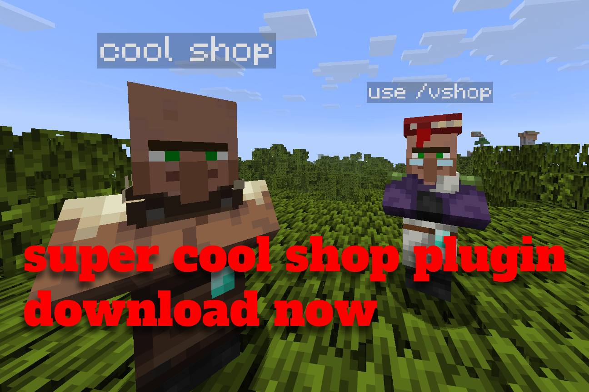
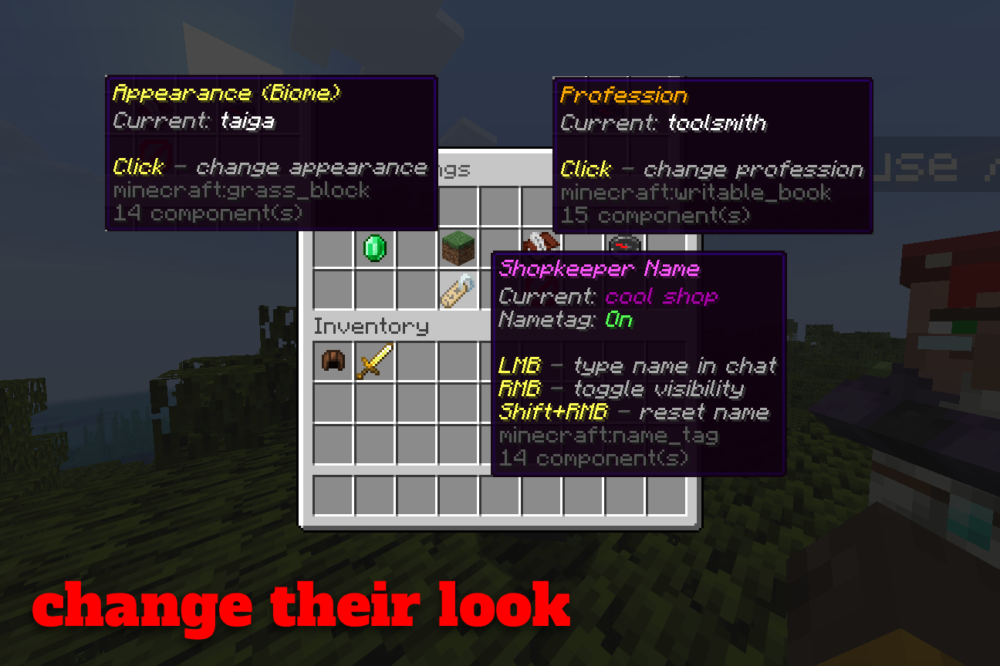
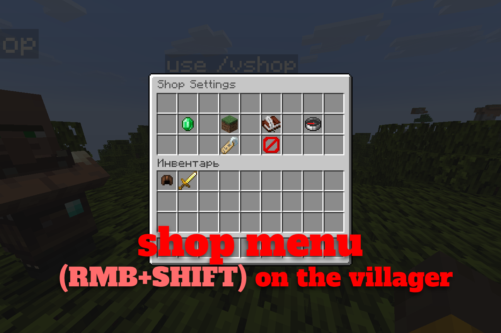
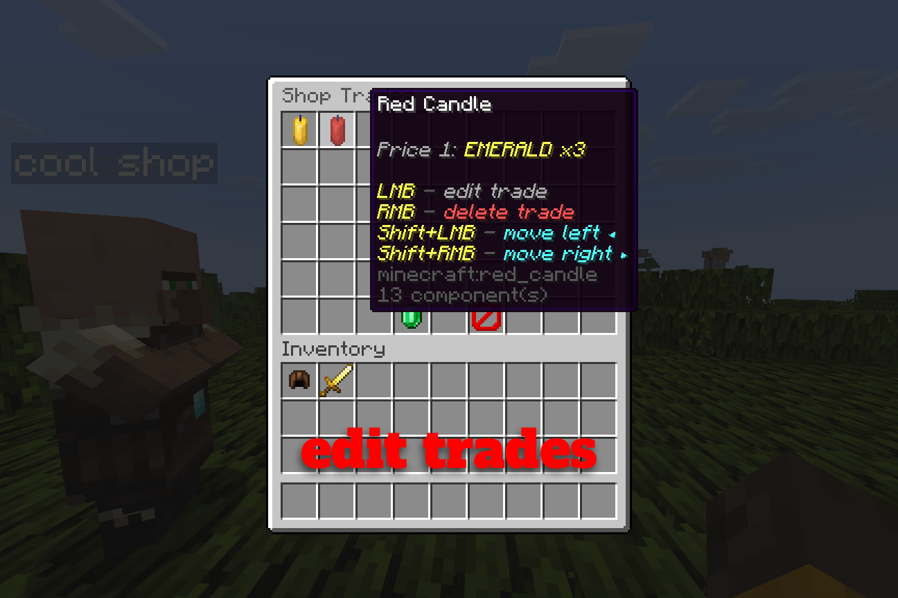

# VillagerShopPlus

A Paper plugin for creating custom villager shops with custom trades, appearances, and names entirely through in-game menus.

Made for **Paper 26.x**.



## Features

- **Immortal & Fixed:** Villagers cannot take any damage, die, or be pushed around by players, mobs, or water.
- **Simultaneous Trading:** Multiple players can browse and trade with the same villager at the same time without blocking each other.
- **Full GUI Setup:** Just crouch + right-click any shopkeeper to open the settings.
- **Safe Trade Builder:** Setting up trades uses a template system. Clicking a slot with an item sets it as a sample without consuming or duplicating items from your inventory.
- **Trade Management:** Easily reorder trades or edit existing ones directly in the menu.
- **Customizable Appearance:** Change the villager's biome skin and profession on the fly without wiping existing trades.
- **Nametags:** Supports MiniMessage and color codes. You can toggle nametag visibility above the head with one click.
- **Infinite Trades:** Trades never lock up, demand price increases are disabled, and villagers don't drop trading XP.



## How to Use

1. Spawn a shopkeeper using `/vshop spawn [biome] [profession]`.  
   *(Example: `/vshop spawn swamp toolsmith`)*
2. **Crouch + Right-Click** the villager to open the control menu.
3. Go to **Manage Trades** -> **+ New Trade**:
    - Click a slot with an item on your cursor to set it as a sample.
    - Click with an empty hand to clear a slot.
    - Click the green button to save.
4. Managing existing trades:
    - **LMB** — edit trade
    - **RMB** — delete trade
    - **Shift + LMB** — move trade left
    - **Shift + RMB** — move trade right




## Commands & Permissions

| Command | Description | Permission | Default |
| :--- | :--- | :--- | :--- |
| `/vshop spawn [type] [prof]` | Spawn a new shopkeeper NPC | `villagershop.spawn` | `op` |
| `/vshop move` | Teleport the nearest shopkeeper to you | `villagershop.edit` | `op` |
| `/vshop edit` | Open settings for the nearest shopkeeper | `villagershop.edit` | `op` |
| `/vshop reload` | Reload configuration & language files | `villagershop.reload` | `op` |
| `/vshop help` | Display plugin help and commands | *None* | Everyone |

> The permission `villagershop.admin` gives access to all commands and features (default: `op`).

## Languages

The plugin supports localization via files in the `plugins/VillagerShopPlus/lang/` folder:

- `en_us.yml` (English — default)
- `ru_ru.yml` (Russian)

You can switch the language in `config.yml`:
```yaml
language: "en_us" # or "ru_ru"
```
Then run `/vshop reload`. You can also create your own translation file by copying one of the defaults.

---
Plugin by **Scriptyyy**.